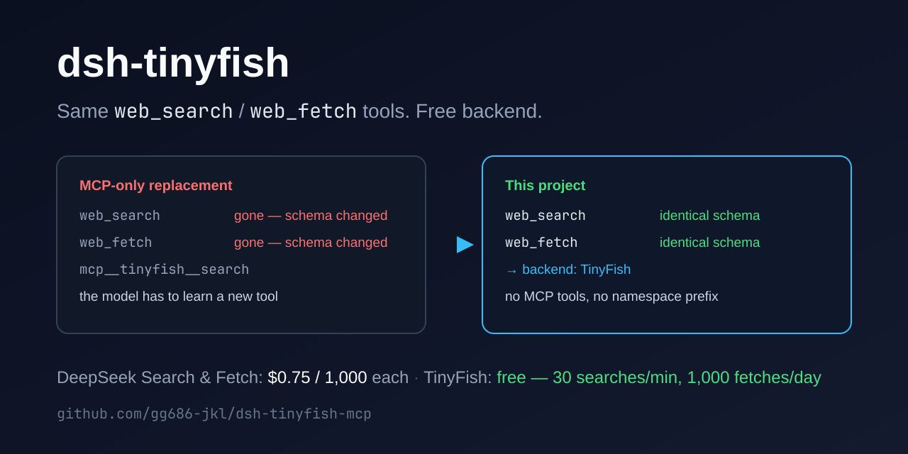

# dsh-tinyfish

**dsh keeps its own `web_search` / `web_fetch` tools — TinyFish becomes the free backend behind them.**

English | [中文](README.zh.md)



- **The model-facing tools do not change.** The shipped `@deepseek-ai/dsh-tool-web` plugin keeps owning
  the names, parameter schemas, descriptions and output rendering of `web_search` and `web_fetch`. This
  project only registers TinyFish on the `ctx.web` capability seam, so a model trained on the official
  tools sees exactly the shapes it already knows. No MCP tools are mounted, so no `mcp__*` names and no
  schemas to relearn.
- **Free.** TinySearch is $0 per request (30/min, 500/hour), TinyFetch is $0 per URL (150/min,
  1,000/day), and neither draws from the TinyFish wallet — they keep working at a $0 balance. DeepSeek's
  Search & Fetch APIs bill **$0.75 per 1,000 requests each**.
- **One command, reversible.** A marked block in the current profile's `cordis.patch.yml`; the first
  install leaves a `.bak`. The key lives in `$DSH_HOME/tinyfish.key` (mode 600) and never enters YAML.
- **Desktop, phone, remote profiles.** Same script for desktop `dsh` and the dsh-go Android app; nothing
  to hand-edit, nothing to install (the web tools ship with dsh).

<details>
<summary><b>Let an agent install it</b> — copy the prompt, fill in your key</summary>

```text
Switch this machine's dsh profile from DeepSeek's paid Search & Fetch API to TinyFish, without changing what the model sees: the installed @deepseek-ai/dsh-tool-web must keep providing web_search / web_fetch with their official names and parameters - the script only registers TinyFish as the ctx.web provider. Work in order and stop if a step fails.

TinyFish key: sk-tinyfish-xxxx

1. `command -v dsh` must print a path. Note $DSH_PROFILE and $DSH_PROFILE_DIR; that is the profile to patch, do not pick another.
2. git clone https://github.com/gg686-jkl/dsh-tinyfish-mcp.git
   (no git: curl -fsSL https://codeload.github.com/gg686-jkl/dsh-tinyfish-mcp/tar.gz/refs/heads/main | tar xz)
3. cd dsh-tinyfish-mcp && node install.mjs --key sk-tinyfish-xxxx
   If it reports that it cannot find the dsh installation, re-run with DSH_INSTALL=/opt/dsh in front.
4. Report these printed lines verbatim: provider row mounted / web seam pointed at tinyfish / official web_search/web_fetch enabled. Any false means the install failed - say so.
5. Run: dsh --profile "${DSH_PROFILE:-web}" --dump-config | grep -c 'web-tinyfish'   (expect 1)
6. Tell me to restart the app and open a new session; the current session keeps the tools it started with. In the new session web_search / web_fetch should be listed exactly as before, and results should come from TinyFish.

Constraints: only the current profile's cordis.patch.yml may change (the script backs it up); do not edit package.json, create AGENTS.md, or touch other profiles; do not remove or disable tool-web, and do not hand-write tool schemas. Full version: PROMPT.md.
```

</details>

## Install

Free key: <https://agent.tinyfish.ai/api-keys>

```bash
git clone https://github.com/gg686-jkl/dsh-tinyfish-mcp.git
cd dsh-tinyfish-mcp
node install.mjs --key sk-tinyfish-xxxx
```

No git (usual on a phone):

```bash
curl -fsSL https://codeload.github.com/gg686-jkl/dsh-tinyfish-mcp/tar.gz/refs/heads/main | tar xz
cd dsh-tinyfish-mcp-main && node install.mjs --key sk-tinyfish-xxxx
```

Then restart the app and open a **new** session; the current one keeps the tools it started with.

## What you get

Nothing in the tool list moves. That is the point:

| | before | after |
| --- | --- | --- |
| Tools the model sees | `web_search`, `web_fetch` | `web_search`, `web_fetch` — same names, same schemas, same descriptions |
| Who sends the request | DeepSeek Search & Fetch API | TinyFish Search & Fetch API |
| Cost | $0.75 / 1,000 searches and fetches | **$0** (rate-limited, no card) |
| Extra namespaced tools | — | none |

## How it works

`dsh-tool-web` is deliberately a thin, provider-agnostic layer: it owns schemas, validation and
rendering, and talks to whatever provider is registered on the `ctx.web` seam.

```text
model
  │  web_search / web_fetch          official tool definitions (@deepseek-ai/dsh-tool-web)
  ▼
ctx.web                             provider selection: searchProvider / fetchProvider
  │
  ├─ search ──► provider "tinyfish" ──► GET  https://api.search.tinyfish.ai?query=…
  └─ fetch  ──► provider "tinyfish" ──► POST https://api.fetch.tinyfish.ai  {"urls":[…]}
```

`provider/index.mjs` is ~150 lines of plain ESM with no dependencies. It reads the API key from
`$DSH_HOME/tinyfish.key` and maps TinyFish responses onto the seam's `WebSearchResult` /
`WebFetchResult` shapes.

## Cost

| Product | Price | Limits |
| --- | --- | --- |
| [TinySearch](https://www.tinyfish.ai/pricing) | **$0** per request | 30 / min, 500 / hour (≈ 12,000 / day) |
| [TinyFetch](https://www.tinyfish.ai/pricing) | **$0** per URL | 150 / min, 1,000 / day |
| [DeepSeek Search](https://api-docs.deepseek.com/quick_start/pricing/) | $0.75 / 1,000 requests | — |
| [DeepSeek Fetch](https://api-docs.deepseek.com/quick_start/pricing/) | $0.75 / 1,000 requests | — |

TinySearch and TinyFetch never touch the TinyFish wallet, even at a $0 balance. TinyFish's paid
products (TinyAgent $0.016/step, TinyBrowser $0.002/min, TinyMonitor $0.005/check, Research past the
free daily runs) are not mounted by this project — see [Paid extras](#paid-extras) if you want them.

## Check

```bash
dsh --profile "${DSH_PROFILE:-web}" --dump-config | grep -c 'web-tinyfish'   # expect 1
dsh --profile "${DSH_PROFILE:-web}" --dump-config | grep -A2 "id: web$"      # searchProvider: tinyfish
```

The install prints `provider row mounted: true`, `web seam pointed at tinyfish: true` and
`official web_search/web_fetch enabled: true`. If any is `false`, it did not apply.

## Undo / after upgrading dsh

```bash
node install.mjs --revert    # restore the built-in web tools
node install.mjs --force     # regenerate for the new dsh version / after moving this repo
```

## What it touches

- One marked block in the current profile's `cordis.patch.yml`; the first install leaves a `.bak`.
- The block adds a `web-tinyfish` provider row and points the `web` row at it (`searchProvider` /
  `fetchProvider: tinyfish`). Shipped presets are **not** modified, so every preset keeps its official
  web tools — now served by TinyFish.
- The key lives in `$DSH_HOME/tinyfish.key` (mode 600); the YAML only contains a `!!js` expression that
  reads it at activation time.

## Paid extras

Everything TinyFish gives away for free is search and fetch, which the official tools already cover.
Browser automation, deep research, datasets and monitors are wallet-billed; if you want them anyway:

```bash
node install.mjs --key sk-tinyfish-xxxx --with-mcp
```

That mounts the TinyFish MCP server as well, which brings back `mcp__tinyfish__*` tool names (the MCP
layer namespaces tools per server — that cannot be renamed). `--force` without `--with-mcp` removes it
again.

## Not for you if

- You need TinyFish's advanced fetch parameters (`format`, CSS selectors, up to 10 URLs per call) or
  search parameters (`domain_type`, `location`, `language`, recency). The official `web_fetch` /
  `web_search` schemas are fixed, which is exactly what makes them familiar to the model. Use
  `--with-mcp` for the raw tools.
- You want browser automation or deep research from the same session — also `--with-mcp`, and those
  cost money.

## If it fails

- `could not find the dsh installation` — prefix `DSH_INSTALL=/opt/dsh` (the dsh-go location).
- Installed into the wrong profile — `--profile <name>`; the default follows `$DSH_PROFILE`.
- `WEB_PROVIDER_UNAVAILABLE` in a new session — the key file is missing: check
  `ls -l $DSH_HOME/tinyfish.key` (mode 600) and its contents.
- TinyFish rejects the key (401/403) — regenerate it and run
  `node install.mjs --key sk-tinyfish-新key --force`.
- Tools still absent in a new session — restart the dsh process, not just the page.

Requires dsh ≥ 0.2. No dependencies are installed.

## v1.1 — what changed

v1.0 removed `tool-web` and replaced the built-in tools with TinyFish's MCP tools, so the model saw
`mcp__tinyfish__*` instead. v1.1 keeps the official `web_search` / `web_fetch` exactly as shipped and
moves TinyFish behind them. Existing installs upgrade in place:

```bash
node install.mjs --force    # drops the old MCP-only block, keeps the key
```

---

MIT
