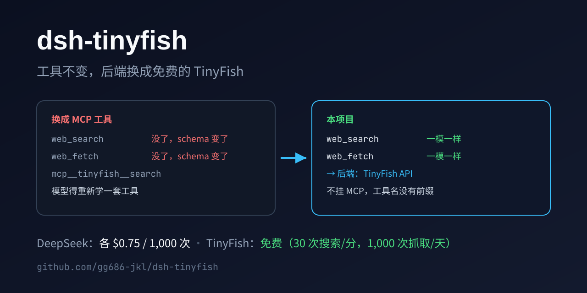

# dsh-tinyfish

**给 dsh 免费用上搜索和抓取 —— 而且不改变模型已经认识的工具。**

[English](README.md) | 中文



## 让 agent 帮你装

复制下面这段，把 key 换成你自己的，丢给任意 coding agent（dsh、Claude Code、Codex 都行）—— 它自带步骤，装完会自检。

```text
把本机 dsh 的网页搜索/抓取换成免费的 TinyFish，作为官方 web_search / web_fetch 的后端。
不要删除、禁用或替换 tool-web，工具的名字和参数必须保持官方原样。

Key: sk-tinyfish-xxxx

git clone https://github.com/gg686-jkl/dsh-tinyfish.git && cd dsh-tinyfish
node install.mjs --key sk-tinyfish-xxxx        # 用户指定了 profile 才加 --profile <名字>

然后：原样贴回脚本打印的三行（provider row mounted / web seam pointed at tinyfish / official
web_search/web_fetch enabled），运行 `dsh --profile "${DSH_PROFILE:-web}" --dump-config | grep -c
web-tinyfish`（期望 1），并提醒我重启 app、开新会话。只允许改当前 profile 的 cordis.patch.yml
（脚本会先备份）；不要写 AGENTS.md。任何一步失败就直说，不要假装成功。
完整版：https://github.com/gg686-jkl/dsh-tinyfish/blob/main/PROMPT.md
```

## 或者自己装

先领免费 key：<https://agent.tinyfish.ai/api-keys>，然后：

```bash
git clone https://github.com/gg686-jkl/dsh-tinyfish.git
cd dsh-tinyfish
node install.mjs --key sk-tinyfish-xxxx
```

没有 git（手机上常见）：

```bash
curl -fsSL https://codeload.github.com/gg686-jkl/dsh-tinyfish/tar.gz/refs/heads/main | tar xz
cd dsh-tinyfish-main && node install.mjs --key sk-tinyfish-xxxx
```

重启 dsh，开一个**新会话**。搞定 —— 此后搜索和抓取都走 TinyFish。

## 检查

```bash
dsh --profile "${DSH_PROFILE:-web}" --dump-config | grep -c web-tinyfish   # 期望 1
```

## 撤销

```bash
node install.mjs --revert
```

## 常见问题

**工具会变吗？** 不会。`web_search` / `web_fetch` 的名字、参数 schema、描述、输出格式都是官方原版；
本项目只是把 TinyFish 注册成 `ctx.web` 的 provider，模型看到的还是它训练时认识的那两个工具。

**要花钱吗？** 不用。TinySearch 免费（30 次/分），TinyFetch 免费（1,000 URL/天），都不扣钱包；
DeepSeek 的 Search & Fetch 是各 $0.75 / 1,000 次。

**浏览器自动化、深度研究呢？** 那些 TinyFish 收费，所以默认不挂。需要的话
`node install.mjs --key … --with-mcp`，会以 `mcp__tinyfish__*` 的形式加进来。

**那为什么不整个用 TinyFish 的 MCP？** 它的工具名会被加上命名空间（`mcp__tinyfish__search`），参数也不一样，
模型得重新学；保留官方工具没有这个代价。

**dsh-go 手机端能用吗？** 能，同样的命令，不装任何依赖。

**以前装过 MCP-only 的旧版？** `node install.mjs --key … --force` 原地升级。

## 说明

- 需要 dsh ≥ 0.2；除了这个仓库本身，什么都不装。
- key 存在 `$DSH_HOME/tinyfish.key`（mode 600），不进 YAML。
- 需要 TinyFish 的高级抓取参数（`format`、CSS selector、一次 10 个 URL），或者想在同一会话里跑自动化/深研？
  用 `--with-mcp`，那些能力 TinyFish 按量收费。

MIT
